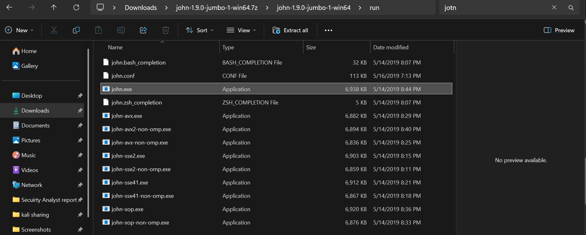
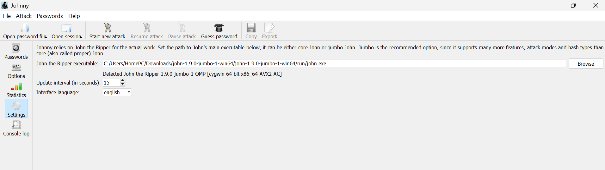
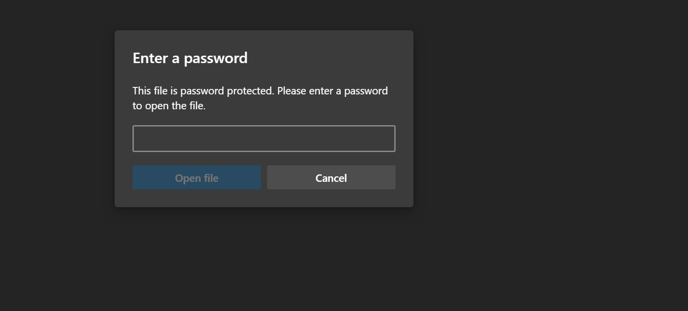
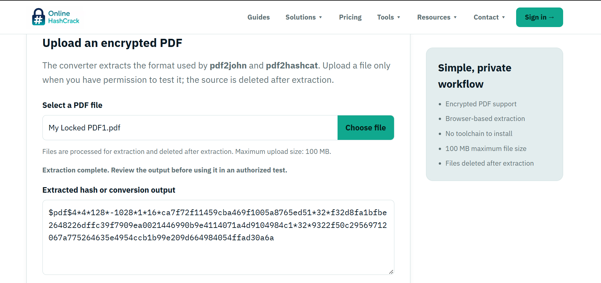
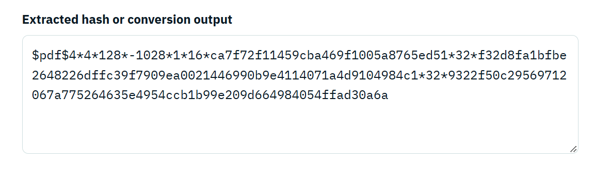
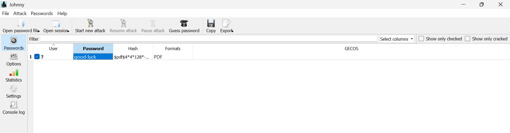

# WEEK 3 – PROJECT MODULE 1: PASSWORD CRACKING WITH JOHN THE RIPPER (JTR)

**Cybersecurity & Ethical Hacking | Networkwalks**

---

## 1. Project Overview

This project involved performing a practical password recovery exercise using **John the Ripper (JTR)** and its graphical interface, **Johnny GUI**.

The objective was to recover the password of a protected PDF document (`My Locked PDF1.pdf`) through password hash extraction and password-cracking techniques.

The exercise provided hands-on experience with password security, PDF encryption, hash extraction, and the use of password auditing tools.

Both the command-line version of John the Ripper and its graphical interface were explored during this exercise.

## 2. Project Objectives

The main objectives of this exercise were:

- Understand how password-cracking tools work.
- Download and configure John the Ripper.
- Install and configure Johnny GUI.
- Understand password-protected PDF documents.
- Extract password hashes from an encrypted PDF.
- Perform password recovery using John the Ripper.
- Understand the importance of strong passwords and document security.

## 3. Tools and Technologies Used

| Tool | Purpose |
|---|---|
| John the Ripper | Password auditing and recovery |
| Johnny GUI | Graphical interface for John the Ripper |
| PDF Hash Extractor | Extracting password hashes from PDF documents |
| Windows PC | Testing environment |
| Protected PDF | Target document for the exercise |

## 4. Practical Implementation

### STEP 1: Downloading John the Ripper

The first step involved downloading John the Ripper from the official Openwall website.

John the Ripper is an open-source password security auditing tool capable of testing password hashes against different password candidates.

**Download source:** https://www.openwall.com/john/

After downloading the package, the files were extracted to the computer.

The `john.exe` executable was located inside the `run` directory.

**Screenshot Evidence:**

*Figure 1: Downloaded John the Ripper package.*

---

### STEP 2: Downloading and Installing Johnny GUI

The next step involved downloading Johnny, the graphical user interface for John the Ripper.

Johnny provides a point-and-click interface that makes interacting with the password-cracking engine easier.

**Download source:** https://openwall.info/wiki/john/johnny

After downloading the setup file, Johnny was installed on the Windows computer.

**Screenshot Evidence:**

*Figure 2: Johnny GUI installation.*

---

### STEP 3: Configuring Johnny with John the Ripper

After installing Johnny, the application was opened and configured to use the John the Ripper executable.

The following configuration process was performed:

1. Open Johnny.
2. Navigate to Settings.
3. Browse for the John the Ripper executable.
4. Locate the `john.exe` file inside the `run` directory.
5. Select the executable.

This configuration connects Johnny's graphical interface to the underlying John the Ripper engine.

**Screenshot Evidence:**

*Figure 3: Configuring Johnny to locate john.exe.*

---

### STEP 4: Preparing the Password-Protected PDF

The next stage involved obtaining the encrypted PDF document provided for the exercise.

**Target file:** `My Locked PDF1.pdf`

The document was used as the target for the password recovery exercise.

The purpose was to obtain the password hash associated with the protected PDF before attempting password recovery.

**Screenshot Evidence:**

*Figure 4: Password-protected

## Step 3: Extracting the PDF Hash and Cracking the Password

In this stage, I used John the Ripper through the Johnny graphical interface to attempt to recover the password of the protected PDF file.

### 3.1 Download the Encrypted PDF

I downloaded the password-protected PDF file (`My Locked PDF1.pdf`) provided for the lab and saved it on my computer.

### 3.2 Extract the PDF Hash

I opened the [Online Hash Crack PDF Hash Extractor](https://www.onlinehashcrack.com/tools-pdf-hash-extractor.php).

I browsed for the encrypted PDF file, selected it, and clicked **Upload** to extract its password hash.

> **Note:** Only upload files you are authorized to share with the service. Uploading a PDF to a third-party website means sending that document to that service.

### 3.3 Copy and Prepare the Extracted Hash

After the extraction process, the website displayed the PDF hash.

I copied the extracted hash value. The hash should begin with `$pdf$`.

If the extracted value contains additional characters, such as `b'` at the beginning, I removed those characters before saving the hash.

### 3.4 Save the Hash in a Text File

I opened Notepad and pasted the extracted hash into a new text document.

I saved the file using the name:

`hash1.txt`

This file would be used by Johnny as the input for the password recovery attempt.

### 3.5 Load the Hash into Johnny

I reopened Johnny and selected **Open password file**.

I browsed to the location where I had saved `hash1.txt`, selected the file, and clicked **Open**.

This loaded the extracted PDF hash into Johnny.

### 3.6 Start the Password Recovery Attempt

After loading the hash, I clicked **Start new attack**.

John the Ripper then began testing password candidates against the extracted hash.

The time required depends on factors such as the computer's processing speed, the PDF encryption settings, and the complexity of the original password.

### 3.7 Verify the Recovered Password

After the recovery process, I used the recovered password to open the original encrypted PDF file.

I entered the recovered password in the PDF password prompt to verify whether it successfully opened the document.

**Result:** [Update this section with your actual result after completing the lab.]

- Password recovery status: [Successful / Unsuccessful]
- PDF verification: [Opened successfully / Not verified]

---

## Key Concepts Learned

**Encryption:** Encryption transforms readable information into an unreadable form using a cryptographic process. With the appropriate key or password, the original information can be recovered.

**Hashing:** Hashing transforms data into a fixed-format value. It is designed to be a one-way process rather than something that can simply be reversed.

**Password Cracking:** John the Ripper tests possible passwords against an extracted password hash to identify a matching password.

**PDF Hash Extraction:** The extraction process obtains the password-related data required by John the Ripper to perform its password recovery attempt.

## Conclusion

Through this practical exercise, I learned how to extract a password hash from an encrypted PDF, prepare the hash in a text file, load it into Johnny, and use John the Ripper to attempt password recovery. I also learned the importance of verifying recovered
